<div align="center">


<a href="https://naresh-ai.com">naresh-ai.com</a> &nbsp;·&nbsp; <a href="https://linkedin.com/in/naresh23">LinkedIn</a> &nbsp;·&nbsp; <a href="mailto:rnaresh23032003@gmail.com">Email</a> &nbsp;·&nbsp; <a href="https://naresh-ai.com/resume.pdf">Résumé</a> &nbsp;·&nbsp; <a href="#research">Research</a>

</div>

<br>

Agents that reason freely but can only act through a typed catalog and a policy gate. Local models that do the default work on a consumer GPU. Logs you can recompute instead of just read. That's the thread through everything below, and every number on this page points at a file you can check.

<br>

## Right now


<sub>[AEGIS](https://github.com/Naresh23032003/AEGIS) · [Nikki](https://github.com/Naresh23032003/Nikki-AI-Companion) · [mcp-approval-gateway](https://github.com/Naresh23032003/mcp-approval-gateway) · [IDR paper](https://github.com/Naresh23032003/idr-stablecoin-fx-basis) · [product-factory-skills](https://github.com/Naresh23032003/product-factory-skills) · [Churn ML](https://github.com/Naresh23032003/MLME)</sub>

<br>

## The work

Six projects, six different problems. Click a card to open its repo.

<p align="center">
<a href="https://github.com/Naresh23032003/AEGIS"></a>
<a href="https://github.com/Naresh23032003/Nikki-AI-Companion"></a>
<a href="https://github.com/Naresh23032003/MLME"></a>
<a href="https://github.com/Naresh23032003/Pocket-Professor"></a>
<a href="https://github.com/Naresh23032003/insight-pulse"></a>
<a href="https://github.com/Naresh23032003/product-factory-skills"></a>
</p>

<details>
<summary><b>How AEGIS works, in one line</b></summary>

<br>

```text
detect  ->  triage  ->  diagnose  ->  plan  ->  policy gate  ->  execute  ->  verify
 rules       LLM         LLM          LLM         OPA            Docker       probes
```

Agents pick a `catalog_key` from a closed, typed action catalog; the executor never imports LLM code. Rego decides per action: green runs, yellow opens a veto window, red waits for an Ed25519-signed human approval. Every event is `sha256(prev_hash ‖ canonical_json)`, and `verify-chain` recomputes the whole log on demand. Runs offline on fixtures with `MOCK_LLM=1`.

</details>

<br>

## Receipts

Anyone can claim quality. These are numbers, and each one lives in a file.

<p align="center"></p>

<details>
<summary><b>Where to check each line</b></summary>

<br>

| Line | Where |
|:--|:--|
| Nikki evals, VRAM budget, RVC latency | `tests/run_evals.py`, `config.yaml`, [Nikki README](https://github.com/Naresh23032003/Nikki-AI-Companion#benchmarks-and-evals) |
| AEGIS MTTR and cost per incident | `docs/reports/PHASE_6_REPORT.md` |
| Prompt-leak ablation, trace queries | Phase 12 and 13 reports, `FINAL_VERIFICATION.md` |
| Churn latency and tests | `artifacts/benchmarks/`, `make test` |

</details>

The bad numbers stay on too. AEGIS's trace-query tool went unused in 0 of 29 live diagnoses, so the agent was never really reading its evidence. Its latency scenario still fails: the root cause, a rule-id and query-key mismatch, [is now fixed](https://github.com/Naresh23032003/AEGIS/pull/15), and the test stays red until its fixture is re-recorded.

<br>

## Research

I run the engineering repos like experiments: a fixed eval set, an ablation, and a result I report even when it's unflattering. The best finding in AEGIS is a negative one. Once I stripped the answers out of the prompt, the agent went from naming faults at 0.8 confidence to restating symptoms at 0.0. It had been reading the prompt, not diagnosing.

| | Paper | Where |
|:--|:--|:--|
| 2026 | Where does the Indonesian cryptocurrency premium come from? *Sole author, working paper* | [replication package](https://github.com/Naresh23032003/idr-stablecoin-fx-basis) |
| 2025 | GenAI-Driven Intelligent Email Ticketing for Sentiment-Aware Customer Support | ICACECS 2025, Springer Nature · [code](https://github.com/Naresh23032003/GenAI-Driven-Intelligent-Email-Ticketing) |
| 2025 | Automated Assessment of Fruit Quality Using Transfer Learning and MobileNetV2 | IJRASET 13(IV) · [DOI](https://doi.org/10.22214/ijraset.2025.68187) |
| 2025 | Enhancing Sentiment Analysis on Amazon Reviews Using Ensemble Learning Models | IJIRT 11(8) · [paper](https://ijirt.org/Article?manuscript=172458) |
| 2024 | Optimizing Delivery Operations in Dynamic Urban Environments | Society of Operations Management, XXVII Annual Conference |

<details>
<summary><b>Questions I'm working on now</b></summary>

<br>

- **Does a diagnosis agent actually read the evidence?** Four of five AEGIS diagnoses answered on turn one with no tool call at all. That's a finding about tool-use incentives, not a bug in the tool.
- **When is a better model not worth promoting?** The churn candidate beats the baseline by 0.0006 ROC AUC but loses on calibration and top-decile precision. A promotion gate should demand a material gain, not just a positive one.
- **Can retrieval learn to say no?** In air-gapped compliance RAG, a verifier traces every figure back to its source or abstains, so abstention becomes something you can measure instead of a failure.
- **Where does a crypto premium come from?** Splitting the Indodax bitcoin premium over JISDOR into a crypto leg and a USDT/IDR stablecoin–FX leg, 2021–2026, on 616k five-minute bars.

The papers before 2026 are collaborative, with authors as printed on each record. Every repository on this page is solo.

</details>

<br>

## The path


<sub>M.Sc Data Science & AI, BITS Pilani · B.Tech + MBA dual degree, IIT Madras · AWS Certified AI and Cloud Practitioner · [full résumé](https://naresh-ai.com/resume.pdf)</sub>

<br>

## Toolkit


<sub>Plus Ollama, ChromaDB, LangGraph, OPA/Rego, OpenTelemetry, faster-whisper and Kokoro. Everything listed is used in a public repo.</sub>

<br>

<picture><source media="(prefers-color-scheme: dark)" srcset="https://raw.githubusercontent.com/Naresh23032003/Naresh23032003/output/snake-dark.svg"><source media="(prefers-color-scheme: light)" srcset="https://raw.githubusercontent.com/Naresh23032003/Naresh23032003/output/snake-light.svg"></picture>

<div align="center">

**Building agents, evals or retrieval that has to be right?** [Let's talk.](mailto:rnaresh23032003@gmail.com)

</div>
