<div align="center">



**Forward Deployed Engineer at VaultStack AI** · ex-Accenture · IIT Madras · BITS Pilani · India

<a href="https://naresh-ai.com">naresh-ai.com</a> &nbsp;·&nbsp; <a href="https://linkedin.com/in/naresh23">LinkedIn</a> &nbsp;·&nbsp; <a href="mailto:rnaresh23032003@gmail.com">Email</a> &nbsp;·&nbsp; <a href="https://naresh-ai.com/resume.pdf">Résumé</a> &nbsp;·&nbsp; <a href="https://orcid.org/0009-0000-0735-2066">ORCID</a>

</div>

<br>

Agents that reason freely but can only act through a typed catalog and a policy gate. Local models that do the default work on a consumer GPU. Logs you can recompute instead of just read. That's the thread through everything below, and every number on this page points at a file you can check.

> **In short:** applied AI engineer and researcher, shipping AI full-time since 2025 at Accenture and VaultStack AI. Four peer-reviewed papers and a solo working paper. Six solo systems below, each with tests or evals you can run.

<br>

## Right now



<sub>[AEGIS](https://github.com/Naresh23032003/AEGIS) · [Nikki](https://github.com/Naresh23032003/Nikki-AI-Companion) · [mcp-approval-gateway](https://github.com/Naresh23032003/mcp-approval-gateway) · [IDR paper](https://github.com/Naresh23032003/idr-stablecoin-fx-basis) · [product-factory-skills](https://github.com/Naresh23032003/product-factory-skills) · [Churn ML](https://github.com/Naresh23032003/MLME)</sub>

<br>

## The work

Six projects, six different problems. Click a card to open its repo, or open the notes underneath for how each one works.

<p align="center">
<a href="https://github.com/Naresh23032003/AEGIS"></a>
<a href="https://github.com/Naresh23032003/Nikki-AI-Companion"></a>
<a href="https://github.com/Naresh23032003/MLME"></a>
<a href="https://github.com/Naresh23032003/Pocket-Professor"></a>
<a href="https://github.com/Naresh23032003/insight-pulse"></a>
<a href="https://github.com/Naresh23032003/product-factory-skills"></a>
</p>

<details>
<summary><b>AEGIS</b> · self-healing incident ops · Python, LangGraph, FastAPI, OPA/Rego, Postgres, Next.js</summary>

<br>

Watches a real three-service system, detects injected faults, has LLM agents diagnose them from live metrics, logs and traces, fixes the low-risk ones itself, and routes risky fixes through a signed human approval.

```text
detect  ->  triage  ->  diagnose  ->  plan  ->  policy gate  ->  execute  ->  verify
 rules       LLM         LLM          LLM         OPA            Docker       probes
```

- **No path from a model to a shell.** Agents pick a `catalog_key` from a closed, typed action catalog. The executor never imports LLM code.
- **A policy gate on every action.** Green runs, yellow opens a veto window, red waits for an Ed25519-signed human approval.
- **A log you can check, not just read.** Every event is `sha256(prev_hash ‖ canonical_json)`, and `verify-chain` recomputes the whole log on demand.
- **Try it offline, no API key:** `git clone https://github.com/Naresh23032003/AEGIS && cd AEGIS && cp .env.example .env && make up`

</details>

<details>
<summary><b>Nikki</b> · local AI companion · FastAPI, Ollama, ChromaDB, React PWA, faster-whisper, Kokoro, RVC</summary>

<br>

A self-hosted companion with streaming chat, long-term memory, voice notes, hands-free calls with a lip-synced avatar, and a WhatsApp bridge, all on a 6 GB GPU.

- **Two-tier routing.** Personal data stays local. An optional cloud tier is budget-capped, can be switched off from config, and logs every outbound payload.
- **Guards in code, not prompts.** Replies that claim actions that never ran get regenerated, and price or news claims with no tool behind them get stripped.
- **91 deterministic evals gate every push**, with no model in the loop: router 64/64, tone 10/10, temporal memory 9/9, journal 8/8.
- **Try it:** `git clone https://github.com/Naresh23032003/Nikki-AI-Companion && cd Nikki-AI-Companion && docker compose up --build`

</details>

<details>
<summary><b>Churn ML system</b> · production ML · Python, scikit-learn, FastAPI, Docker</summary>

<br>

Predicts which wholesale customers will stop ordering in the next 90 days, so a small retention team calls the right accounts. The model is the smallest part.

- **Chronology respected.** 128,693 rows across 43 weekly snapshots, split strictly in time with a 90-day embargo.
- **A gate that isn't a formality.** The candidate passes all five promotion rules, and the design doc still argues for the simpler baseline: +0.0006 ROC AUC doesn't pay for worse calibration.
- **Monitoring that can say "don't retrain".** Real drift returns `TRIGGER_RETRAINING`; a null flood returns `PAGE_DATA_ENGINEERING` instead.
- **Reproduce everything:** `make setup && make all` (about three minutes, 124 tests).

</details>

<details>
<summary><b>Pocket Professor</b> · voice-first learning · Expo, React Native, Supabase, Deno, Groq</summary>

<br>

Paste a YouTube link or a PDF and get notes and flashcards, then answer out loud while an LLM grades what you actually said.

- **Real spaced repetition:** FSRS via `ts-fsrs` at 0.9 target retention.
- **The quiz loop is a state machine,** with a 2.5 s budget for spoken feedback and tap-to-override grades.
- **Row-level security on every table**, and the Groq key never leaves an edge function. Every spoken step has a text twin, so it still works muted.

</details>

<details>
<summary><b>Insight Pulse</b> · cloud infrastructure · Next.js, Terraform, AWS EKS, GitHub Actions, Stripe</summary>

<br>

A SaaS taken all the way to managed Kubernetes, with the infrastructure defined as code rather than clicked together.

- **Terraform** builds a VPC with private subnets and an EKS 1.31 cluster whose node groups scale from 1 to 3.
- **Every deploy is pinned to a commit SHA**, so a rollback is a tag change, not a rebuild.
- **Billing wired end to end:** Clerk auth, Stripe checkout and real webhook handlers.

</details>

<details>
<summary><b>product-factory-skills</b> · agent skills · Claude Code plugin, works in Codex, Copilot, Cursor, Antigravity</summary>

<br>

Eight `SKILL.md` skills that take a product from idea to launch: pain mining, idea validation, spec, agent task writing, security scanning, README and demo, launch playbook, and AARRR metrics. Each one has a cited method and an exit check.

**Install:** `/plugin marketplace add Naresh23032003/product-factory-skills`, then `/plugin install product-factory@product-factory`

</details>

<br>

## Receipts

Anyone can claim quality. These are numbers, and each one lives in a file.

<p align="center"></p>

<details>
<summary><b>Where to check each line</b></summary>

<br>

| Line | Where |
|:--|:--|
| Nikki evals, VRAM budget, RVC latency | `tests/run_evals.py`, `config.yaml`, [Nikki README](https://github.com/Naresh23032003/Nikki-AI-Companion#benchmarks-and-evals) |
| AEGIS MTTR and cost per incident | `docs/reports/PHASE_6_REPORT.md` |
| Prompt-leak ablation, trace queries | Phase 12 and 13 reports, `FINAL_VERIFICATION.md` |
| Churn latency and tests | `artifacts/benchmarks/`, `make test` |

</details>

The bad numbers stay on too. The AEGIS agent called its trace-query tool 0 times in 29 live diagnoses, so it was never really reading its evidence. Its latency scenario still fails: the root cause, a rule-id and query-key mismatch, is now fixed, and the test stays red until its fixture is re-recorded.

<br>

## Research

I run the engineering repos like experiments: a fixed eval set, an ablation, and a result I report even when it's unflattering. The best finding in AEGIS is a negative one. Once I stripped the answers out of the prompt, the agent went from naming faults at 0.8 confidence to restating symptoms at 0.0. It had been reading the prompt, not diagnosing.

| | Paper | Where |
|:--|:--|:--|
| 2026 | Where does the Indonesian cryptocurrency premium come from? *Sole author, working paper* | [replication package](https://github.com/Naresh23032003/idr-stablecoin-fx-basis) |
| 2025 | GenAI-Driven Intelligent Email Ticketing for Sentiment-Aware Customer Support | ICACECS 2025, Springer Nature · [code](https://github.com/Naresh23032003/GenAI-Driven-Intelligent-Email-Ticketing) |
| 2025 | Automated Assessment of Fruit Quality Using Transfer Learning and MobileNetV2 | IJRASET 13(IV) · [DOI](https://doi.org/10.22214/ijraset.2025.68187) |
| 2025 | Enhancing Sentiment Analysis on Amazon Reviews Using Ensemble Learning Models | IJIRT 11(8) · [paper](https://ijirt.org/Article?manuscript=172458) |
| 2024 | Optimizing Delivery Operations in Dynamic Urban Environments | Society of Operations Management, XXVII Annual Conference |

<sub>Full record on [ORCID](https://orcid.org/0009-0000-0735-2066). The papers before 2026 are collaborative, with authors as printed on each record. Every repository on this page is solo.</sub>

<details>
<summary><b>Questions I'm working on now</b></summary>

<br>

- **Does a diagnosis agent actually read the evidence?** Four of five AEGIS diagnoses answered on turn one with no tool call at all. That's a finding about tool-use incentives, not a bug in the tool.
- **When is a better model not worth promoting?** The churn candidate beats the baseline by 0.0006 ROC AUC but loses on calibration and top-decile precision. A promotion gate should demand a material gain, not just a positive one.
- **Can retrieval learn to say no?** In air-gapped compliance RAG, a verifier traces every figure back to its source or abstains, so abstention becomes something you can measure instead of a failure.
- **Where does a crypto premium come from?** Splitting the Indodax bitcoin premium over JISDOR into a crypto leg and a USDT/IDR stablecoin–FX leg, 2021–2026, on 616k five-minute bars.

</details>

<br>

## The path



<details>
<summary><b>What I did in each role</b></summary>

<br>

- **VaultStack AI · Forward Deployed Engineer · Jun 2026 – now.** Air-gapped RAG for financial compliance due diligence, running fully offline on self-hosted models: hybrid dense and sparse retrieval, Docling table extraction, BGE-M3 with cross-encoder re-ranking, and a verifier that traces every figure to its source or abstains.
- **Accenture · AI Decision Science Analyst · Jan 2025 – Apr 2026.** A multi-agent decision platform for production planning, MILP supply-chain tooling with CPLEX and Gurobi behind Django and React, Databricks and Azure Data Factory pipeline fixes, and customer segmentation in production.
- **Razorpay · Product Development Intern · Jul – Oct 2024.** Automated personalised PDF reports for 200+ merchants with A/B testing, and an admin dashboard feature that saved about four hours of manual work per merchant.
- **TVS Electronics · ML Intern · May – Jul 2024.** RAG over service data on AWS Bedrock with Llama 3, plus an NLP cleaning pipeline and a Streamlit prototype.
- **Earlier:** Generative AI intern at Tecnod8, software development intern at Razorpay, summer intern at Royal Enfield.

</details>

<sub>M.Sc Data Science & AI, BITS Pilani · B.Tech + MBA dual degree, IIT Madras · AWS Certified AI and Cloud Practitioner · [full résumé](https://naresh-ai.com/resume.pdf)</sub>

<br>

## Toolkit


<sub>Also Ollama, ChromaDB, LangGraph, OPA/Rego, OpenTelemetry, faster-whisper and Kokoro. At work: Azure, Databricks, CPLEX, Gurobi.</sub>

<br>

<picture><source media="(prefers-color-scheme: dark)" srcset="https://raw.githubusercontent.com/Naresh23032003/Naresh23032003/output/snake-dark.svg"><source media="(prefers-color-scheme: light)" srcset="https://raw.githubusercontent.com/Naresh23032003/Naresh23032003/output/snake-light.svg"></picture>

## Let's talk

If you're putting an agent anywhere near production systems, building retrieval that must not invent numbers, or shipping a model that needs a real promotion gate, I've done each of those and I'm glad to compare notes.

**[rnaresh23032003@gmail.com](mailto:rnaresh23032003@gmail.com)** · [LinkedIn](https://linkedin.com/in/naresh23) · [naresh-ai.com](https://naresh-ai.com)
